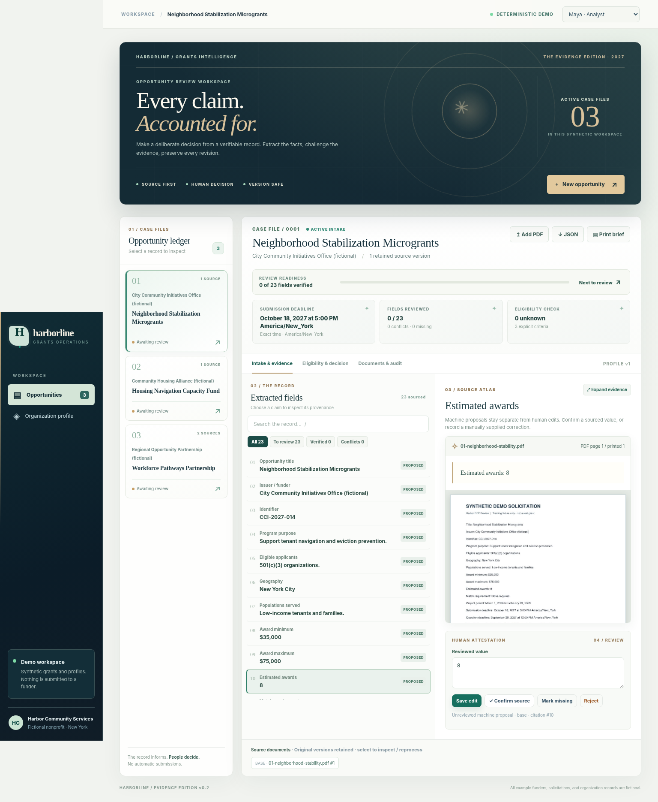

# Harborline — RFP Intake & Bid/No-Bid Preparation

**Status: working, local, synthetic-data demo — not a production grants system.**

**Evidence Edition v0.2:** An editorial, source-first visual system with a dark case-file masthead, distinctive typographic hierarchy, illuminated provenance styling, accessible review readiness, filters and search, expanded source inspection, and a responsive mobile workspace. The visual style is intentionally theatrical; the underlying decision workflow remains explicit and conservative.

**Primary user:** a nonprofit grants analyst who prepares evidence-backed intake briefs for a director. **Promise:** a solicitation, its amendments, and an organization profile become a page-cited, editable review workspace and a human-authored bid/no-bid discussion record. **Assumptions:** the initial organization, issuers, opportunities, and users are fictional; no external credentials, buyers, or funder integration are available. **Smallest complete workflow:** import a PDF → extract field candidates with citations → compare explicit requirements with a versioned profile → confirm/edit fields → record a director decision → export JSON or print a brief. The riskiest dependency is reliable PDF/OCR extraction, deliberately narrowed to a deterministic, labeled demonstration adapter rather than simulated AI accuracy.



[Mobile preview](docs/mobile-preview.png)

## Run locally

Requires **Node.js 22.16+**, **Python 3.11+**, and Tesseract OCR. Python packages: `pymupdf`, `pillow`, `pytesseract`. Regenerating the PDF fixtures also requires `reportlab`. SQLite is built into Node 22 but emits an experimental warning on this version.

```bash
# In the project directory:
python -m pip install pymupdf pillow pytesseract
# On Debian/Ubuntu, if necessary: sudo apt-get install tesseract-ocr
npm run dev
# Open http://127.0.0.1:4173 in your local browser
```

The runtime does not call paid APIs and does **not** require `npm install`; it uses Node's built-in HTTP/SQLite modules and native TypeScript stripping. If you want to type-check, run `npm install` to obtain TypeScript and Node type definitions, then `npm run typecheck`. For tests:

```bash
npm test
```

The first startup seeds three fictional opportunities. Their fixtures and extracted data are stored under `data/` locally. Reopen or reload the application to confirm persistence. **Do not expose this server to the internet:** demo user identities are selectable, not real authentication.

## Quick operator guide

1. **Choose an opportunity** in the left pipeline. Review the deadline, provenance, and machine-proposed fields. All values are unreviewed until a person acts.
2. Select a field. The right panel shows its source excerpt, PDF page index, printed page label (when detected), original page preview, and OCR warning. **Confirm source** to accept the proposal, **Save edit** to record a human-supplied value, or **Mark missing / Reject** as appropriate.
3. Select **Eligibility & decision** to examine only requirements explicitly compared with the Harbor profile. The scanned housing package intentionally reports an **unknown** HUD-approved credential. Unknown never silently becomes pass.
4. Find work quickly with the **All / To review / Verified / Conflicts** filters, the field search, or **Next to review**. Press `/` to focus field search, `Alt+N` to advance to the next unreviewed field, and **Expand evidence** to widen the source panel. All reviewer actions remain subject to the same backend validation and audit trail.
5. Switch the header reviewer to **Avery · Director** to record *pursue*, *decline*, or *needs discussion*, with a required rationale. The analyst cannot record this decision in demo mode.
6. Choose **Print brief** for a readable print or “Save as PDF” view, or **JSON** for a structured, editable export with field status, candidate provenance, source versions, outstanding questions, decisions, and audit events.
7. Click **Add PDF** to classify an original, amendment, or attachment. Duplicate content is blocked per opportunity using SHA-256. Reprocess a source from **Documents & audit** without overwriting review edits. Create a new opportunity via **New opportunity**.
8. Open **Organization profile** to edit the declared organization facts; each save creates another version and refreshes criteria. **Reset all fictional demo reviews** restores the initial sample workspace; it does not alter non-Harbor records.

### Fixture cases

| Fixture | What to inspect |
|---|---|
| `01-neighborhood-stability.pdf` | Two searchable pages, 23-field schema, explicit no-match, instruction-like sentence ignored |
| `02-housing-scan.pdf` | Image-only tabular page, OCR warning, original printed page 7 despite PDF index 0, missing HUD credential evidence (`unknown`) |
| `03-workforce-base.pdf` + `03-workforce-amendment.pdf` | New proposal of **Dec 3, 2027 at 3 p.m. America/New_York** versus retained **Nov 20, 2027 at 5 p.m.** original; changed accepted values need re-review; missing match remains unknown, not $0 |

## Architecture & boundaries

- **Web/UI:** dependency-light static HTML/CSS/JavaScript, served by a TypeScript HTTP service (`src/server.ts`); responsive, keyboard-focus-visible operational screens.
- **Persistence:** local SQLite (`node:sqlite`), schema and foreign keys defined in `src/db.ts`. Tables represent `OrganizationProfileVersion`, `Opportunity`, `SourceDocumentVersion`, `SourcePage`, `IngestionRun`, `ExtractedFieldCandidate`, `Citation`, `EligibilityCriterion`, `ReviewDecision`, `Deadline`, `AuditEvent`, plus `FieldReview` to keep human edits separate.
- **Document processing:** `tools/pdf_adapter.py` extracts PDF text with PyMuPDF and invokes Tesseract on image-only pages. `src/domain.ts` recognizes only fixed `Field: Value` lines. PDF page images allow visual verification; uploaded or embedded links are never followed.
- **Evidence:** every machine candidate has a foreign-keyed citation to a page and an excerpt checked against stored source text. Human edits are separately labeled and audited. Role, content hash, and page indexes survive exports. Source amendments append, never replace the original.
- **Decisions:** three deterministic demo checks (501(c)(3), NYC geography, HUD-approved counseling credential), explicitly labeled preliminary. No numerical AI confidence scores; unknown stays unknown; a director must explicitly decide.
- **Time:** timezone-aware deadlines normalize to UTC instants, while the original wording and zone remain stored. Date-only and unparsed deadlines are not treated as timestamps.
- **Security boundary:** loopback-only demo with a simulated persona cookie, organization-scoped SQLite queries, 8 MB PDF limit, no remote API calls, escaped text rendering, no model-driven actions, and no raw document payloads in audit logs. There is **no actual login/security model**. `DEMO_MODE=false` deliberately refuses to start.

## Test results and acceptance trace

`npm test` uses Node's built-in test runner. The latest run completed **4 tests / 4 passing**, including an integrated HTTP/database workflow. The integrated test asserts: amendment precedence proposal, stale accepted-value flag, UTC normalization in/out of DST, absent fields, OCR table extraction, unsupported content ignored, verified citation excerpts, duplicate upload idempotency, reprocessing without replacing edits, malformed upload rejection, cross-organization read denial, analyst/director permission boundary, JSON/print exports, and reload-persistent records. Run it again after modifications; results here are not a claim about later environments.

`tools/browser_visual_check.py` tested three SPA tabs, 23 fields, selecting a field, search, review-state filters, next-action navigation, evidence-pane expansion, the profile dialog, and desktop/mobile layout using current API snapshots injected into Chromium. Run it with `npm run test:visual` after starting the server. **Limitation:** the browser runner here blocks navigation to the local HTTP server; therefore this is a visual/component check, *not* full networked end-to-end browser verification. Actual HTTP endpoints were tested separately. Screenshots are in `docs/desktop-preview.png` and `docs/mobile-preview.png`.

## Implementation status / deliberate gaps

| Capability | Status |
|---|---|
| Local create/upload/classify, persistent pages, 3 synthetic packages | Implemented |
| Scanned OCR, page images, printed labels, source version/hash | Implemented; OCR requires review |
| 23 fixed intake fields and evidence-backed candidates | Implemented for synthetic `Field: Value` style PDFs; generalized production extraction not implemented |
| Confirm/edit/missing/reject and separate human review record | Implemented |
| Amendment precedence proposal, conflict/staleness flag, rerun idempotency | Implemented |
| Versioned profile; preliminary pass/fail/unknown criteria | Implemented for three demo patterns; not a general eligibility engine |
| Director decision/rationale, audit log, JSON and print export | Implemented |
| Real authentication, encrypted storage, users/teams, multi-tenant production security | **Not implemented — demo only** |
| Configurable model extraction, structured model-output validation | Interface boundary only; no model calls configured |
| Capability-statement PDF ingestion; automated semantic comparison | **Not implemented** (profile is edited manually) |
| Background job progress/cancel, robust large files, OCR quality scoring | **Not implemented** (uploads run synchronously; visible busy state) |
| Direct generated PDF/DOCX files, application submission, CRM sync | **Not implemented** (browser print-to-PDF and JSON instead) |
| Automated matching of all mandatory activities/attachments | **Not implemented**; source text extracted for human review |

**Retention/deletion:** Local `data/review.sqlite`, uploaded PDFs and page previews remain until explicitly deleted from disk; reset removes Harbor's database rows and re-seeds, but intentionally does not securely wipe orphaned source files. Stop the server and delete the entire local `data/` directory to remove all generated demo records. Do not use this as a confidential-data retention system. The downloadable source archive intentionally **excludes** generated runtime `data/` files, including local test and review records.

## Reference and provenance

Built as a **new implementation** using synthetic data. No performance, adoption, customer, or regulatory claims are inferred or repeated. Every sample agency, recipient, email domain, and grant fact is synthetic. No customer outreach or deployment was performed.

See [`docs/PRODUCT_AND_PILOT.md`](docs/PRODUCT_AND_PILOT.md) for scope, invariants, and a ten-RFP shadow-mode pilot.

## Public GitHub repository

The **public source repository** is [trukwava/harborline-rfp-review](https://github.com/trukwava/harborline-rfp-review). Evidence Edition v0.2 source, synthetic PDF fixtures, desktop/mobile preview images, setup instructions, and tests were published to `main` on October 30, 2026.

Clone it with `git clone https://github.com/trukwava/harborline-rfp-review.git`, install the dependencies described above, then run `npm test` and `npm run dev`. This is a **local-only demonstration**, not a publicly deployed application. Do not expose the loopback-only server to the public Internet or upload real confidential applications without implementing genuine authentication, hardened storage and processing, and a privacy/retention plan.

The original offline Git bundle has its own commit lineage. The GitHub release was uploaded via the authenticated repository API into the newly created public repository; matching release files were checked against their Git blob hashes. See [the publication and security notes](docs/REPO_PUBLICATION.md).
